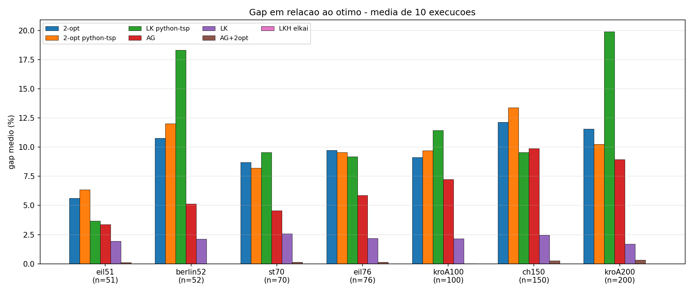
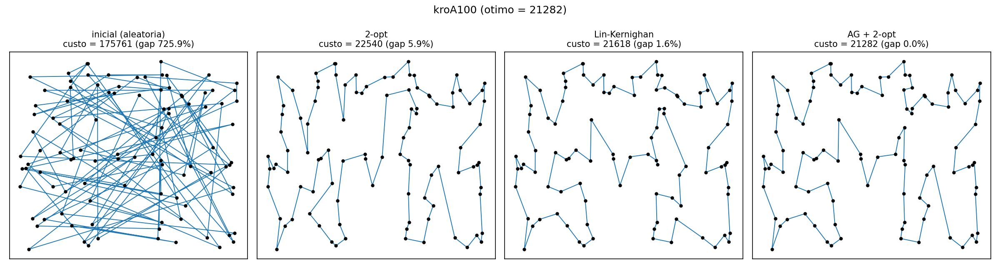

# PIBIC – Algoritmos Evolutivos para o Problema do Caixeiro Viajante

Projeto de Iniciação Científica (PIBIC 2026–2027).

## Métodos

**Implementações próprias (`tsp.py`, aceleradas com numba):**
- **2-opt**: busca local que troca pares de arestas enquanto houver melhora.
- **Lin-Kernighan (LK)**: busca local com trocas encadeadas de profundidade variável, usando lista dos 10 vizinhos mais próximos.
- **AG**: algoritmo genético com crossover OX, seleção por torneio, mutação por inversão e elitismo.
- **AG + 2-opt**: AG híbrido (memético) em que cada indivíduo passa por 2-opt.

**Referências de bibliotecas:**
- **python-tsp**: 2-opt (busca local) e Lin-Kernighan.
- **LKH (elkai)**: implementação do Lin-Kernighan-Helsgaun, usada como referência de estado da arte.

## Estrutura

```
├── tsp.py                  # algoritmos
├── experimentos.py         # roda cada método 10x em cada instância e salva os csv
├── graficos.py             # gera os gráficos
├── instancias/             # instâncias da TSPLIB
├── resultados_brutos.csv   # resultado de cada execução
└── resultados_resumo.csv   # médias, desvios, gap e tempo por método
```

## Como rodar

```
pip install numpy numba pandas matplotlib python-tsp elkai
python experimentos.py
python graficos.py
```

## Metodologia

- 7 instâncias da TSPLIB, de 51 a 200 cidades, com ótimo conhecido.
- 10 execuções por método e instância (seeds 0 a 9); a busca local parte da mesma rota inicial aleatória em todos os métodos.
- Métrica: **gap = (custo − ótimo) / ótimo × 100**.

## Resultados

Gap médio (%) em 10 execuções:

| Instância | n | 2-opt | LK | AG | AG+2opt | 2-opt python-tsp | LK python-tsp | LKH elkai |
|---|---|---|---|---|---|---|---|---|
| eil51 | 51 | 5.61 | 1.95 | 3.38 | 0.12 | 6.36 | 3.66 | 0.00 |
| berlin52 | 52 | 10.78 | 2.12 | 5.14 | 0.00 | 12.03 | 18.32 | 0.00 |
| st70 | 70 | 8.71 | 2.56 | 4.56 | 0.15 | 8.21 | 9.56 | 0.00 |
| eil76 | 76 | 9.74 | 2.18 | 5.87 | 0.15 | 9.55 | 9.18 | 0.00 |
| kroA100 | 100 | 9.13 | 2.15 | 7.24 | 0.01 | 9.69 | 11.44 | 0.00 |
| ch150 | 150 | 12.14 | 2.45 | 9.87 | 0.26 | 13.40 | 9.55 | 0.00 |
| kroA200 | 200 | 11.56 | 1.70 | 8.93 | 0.34 | 10.26 | 19.92 | 0.00 |

   

   

## Principais observações

- O **AG + 2-opt** chegou ao ótimo ou ficou a menos de 0,4% dele em todas as instâncias.
- O **LK próprio** manteve gap médio em torno de 2% e foi melhor que o LK do python-tsp em todas as instâncias.
- O **AG puro** é melhor que o 2-opt, mas fica bem atrás da versão híbrida, o que mostra o ganho de combinar busca global com busca local.
- O **LKH** encontrou o ótimo em todas as execuções e serve de referência.
- Graças ao numba, o 2-opt e o LK próprios rodam em menos de 1 ms, enquanto as versões do python-tsp levam até alguns segundos.
